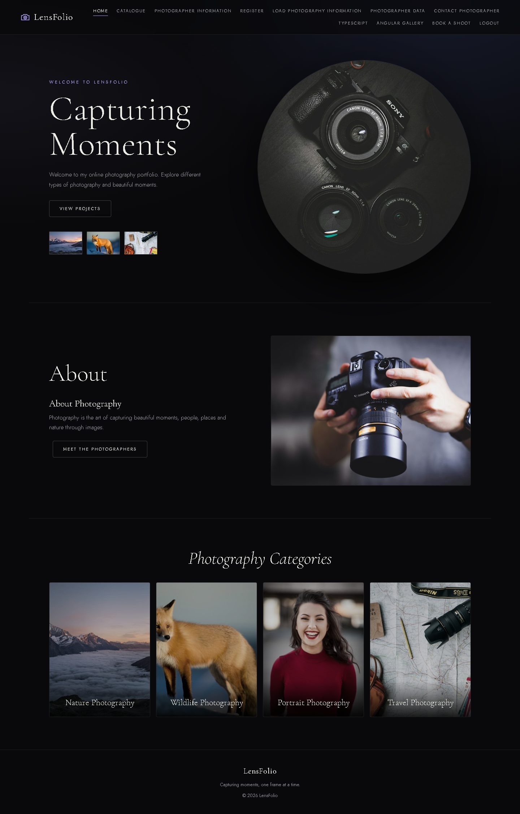

# LensFolio

**Capturing moments, one frame at a time.**

LensFolio is a photography portfolio website built week by week. It starts with plain HTML forms and grows to include CSS, JavaScript validation, XML, the Fetch API, TypeScript, and two Angular apps.



## Design

Every page, including both Angular apps, shares one dark, cinematic theme defined in [week_3/style.css](week_3/style.css):

- **Colours:** near-black background with a soft blue and violet glow, like light on a camera lens
- **Fonts:** *Cormorant Garamond* for headings and *Jost* for body text, both from Google Fonts
- **Layout:** a sticky header with the LensFolio logo and navigation, plus thin-bordered cards, outlined buttons and image grids
- **Home page:** a "Capturing Moments" hero, an About section and a photo grid of categories
- **Responsive:** grids collapse to two columns, then one, on smaller screens

The `week_*` screenshots in [screenshots](screenshots) show each week's original output before the redesign.

## What's in each week

| Week | Folder | Topic | What it does |
|---|---|---|---|
| 1 | [week_1](week_1) | HTML | Login page and home page with navigation |
| 2 | [week_2](week_2) | HTML forms | Registration form with built-in HTML validation |
| 3 | [week_3](week_3) | CSS | Shared stylesheet, plus inline, internal and external CSS examples |
| 4 | [week_4](week_4) | JavaScript | Registration form checked by JavaScript (email, 10-digit phone, matching passwords) |
| 5 | [week_5](week_5) | DOM | Photo catalogue with live search |
| 6 | [week_6](week_6) | XML + DTD | Photographer list in XML, styled with CSS |
| 8 | [week_8](week_8) | Fetch API | Loads a text file without reloading the page |
| 9 | [week_9](week_9) | JSON / XML | Loads and displays photographer data from JSON and XML |
| 10 | [week_10](week_10) | Fetch POST | Contact form that sends JSON to a test API and shows the reply |
| 11 | [week_11](week_11) | TypeScript | Interface, class and typed function compiled to JavaScript |
| 12 | [week_12](week_12) | Angular | Photo gallery: data binding, `*ngFor`/`*ngIf`, parent–child components, custom directive |
| 13–14 | [week_13_14](week_13_14) | Angular SPA | Booking app: routing, services, dependency injection, template-driven form validation |

Screenshots of every week are in [screenshots](screenshots) and in [codebook and outputs](codebook%20and%20outputs), together with the week 10–14 code PDF. The project presentation is `LensFolio_EWP_Presentation.pptx`.

## Running it locally

Open the site through a local web server. If you double-click the HTML files instead, weeks 8, 9 and 12–14 won't work, because browsers block those requests on local files.

Use either of these:

- **VS Code:** install the Live Server extension, right-click `index.html`, and choose **Open with Live Server**.
- **Python:** run this in the project folder, then open http://localhost:8000

  ```bash
  python -m http.server 8000
  ```

`index.html` sends you to the login page. Any email and password will log you in.

## Working on the Angular apps

The built apps are already committed in `week_12/output` and `week_13_14/output`, so the site runs without installing anything. To change one of them:

```bash
cd week_13_14      # or week_12
npm install
npm start          # development server at http://localhost:4200
npm run build      # rebuilds the output/ folder
```

Commit the rebuilt `output/` folder so the live site picks up your change.

To recompile the week 11 TypeScript:

```bash
cd week_11
npx -p typescript tsc
```

## Deploying to Vercel

1. Import this repository at [vercel.com/new](https://vercel.com/new).
2. Set **Framework Preset** to `Other`, override **Build Command** and leave it empty, and override **Output Directory** with `.`
3. Click **Deploy**. Every push to `main` deploys again automatically.

## Built with

HTML, CSS, JavaScript, XML/DTD, JSON, the Fetch API, TypeScript and Angular 21.
